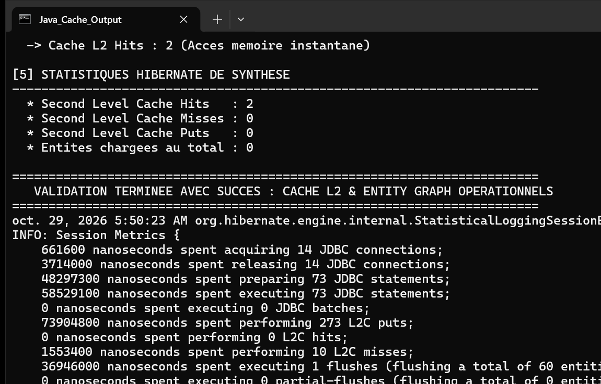

# TP 7 : Cache L2 Ehcache, Entity Graph & Résolution du Problème N+1

Projet d'optimisation avancée des performances sous JPA 2.2 et Hibernate 5.6. Il illustre la mise en évidence et la suppression du problème des requêtes N+1 via deux approches distinctes (`JOIN FETCH` et `Entity Graph`), ainsi que l'activation et le suivi du cache de second niveau (L2) avec Ehcache.

## Fonctionnalités et Techniques Couvertes

### 1. Démonstration du Problème N+1
- Lors du chargement d'une collection en mode `LAZY` (relation 1:N entre `Auteur` et `Livre`), une première requête SQL sélectionne les auteurs, puis N requêtes SQL supplémentaires sont déclenchées individuellement pour charger les livres de chaque auteur.
- Pour 10 auteurs, 11 requêtes SQL sont envoyées à la base de données.

### 2. Résolution via JPQL `JOIN FETCH`
- Requête : `SELECT DISTINCT a FROM Auteur a JOIN FETCH a.livres`
- Une jointure SQL directe (`INNER/LEFT JOIN`) rapatrie l'intégralité des auteurs et de leurs livres en une seule et unique requête SQL, éliminant totalement l'effet de surcharge N+1.

### 3. Résolution Déclarative via Entity Graph
- Annotation déclarée sur l'entité `Auteur` :
  ```java
  @NamedEntityGraph(
      name = "Auteur.livres",
      attributeNodes = @NamedAttributeNode("livres")
  )
  ```
- Injection du hint d'exécution : `query.setHint("javax.persistence.fetchgraph", em.getEntityGraph("Auteur.livres"))`.
- Permet de remplacer dynamiquement la stratégie de chargement `LAZY` par un `EAGER` sans altérer la requête JPQL de base.

### 4. Cache de Second Niveau (L2 Cache avec Ehcache)
- Entités annotées avec `@Cacheable` et `@Cache(usage = CacheConcurrencyStrategy.READ_WRITE)`.
- Configuration de la région d'usine Ehcache (`EhcacheRegionFactory`) et activation du cache de requêtes.
- Les entités consultées dans une session fermée demeurent disponibles en mémoire pour toute nouvelle session, sans réinterroger la base de données (0 requête SQL, Cache Hit immédiat).
- Analyse détaillée via l'API des statistiques Hibernate (`Statistics`).

## Exécution et Tests

### Commandes Maven
Exécution des tests unitaires JUnit :
```bash
mvn clean test
```

Lancement de la démonstration console :
```bash
mvn clean compile exec:java -Dexec.mainClass="com.example.App"
```

## Résultat d'Exécution

La capture ci-dessous illustre l'exécution de la classe principale `com.example.App`.



### Description de la Capture
- L'en-tête confirme l'initialisation de l'unité de persistance `hibernate-cache-pu` et le peuplement de 10 auteurs avec 50 livres.
- Étape 1 : Constat de la surcharge N+1 avec 11 requêtes SQL exécutées.
- Étape 2 : Optimisation `JOIN FETCH` avec une seule requête SQL globale.
- Étape 3 : Optimisation `Entity Graph` chargeant déclarativement les associations en 1 requête.
- Étape 4 & 5 : Démonstration du cache L2 Ehcache illustrant un Cache Hit instantané lors de la seconde session et présentation des compteurs statistiques Hibernate.
- Validation finale complète.
